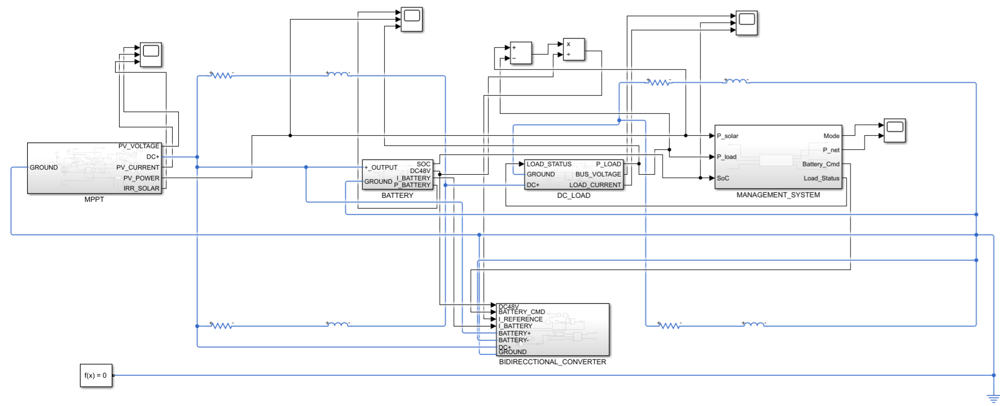
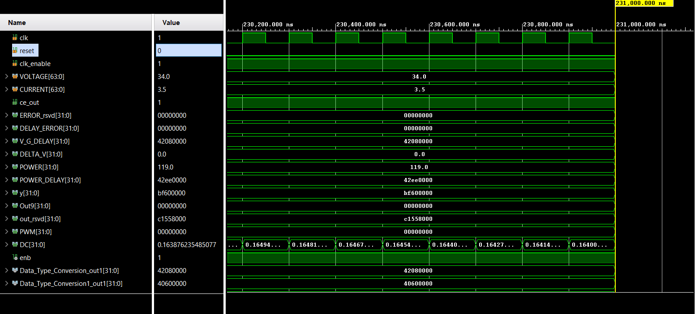
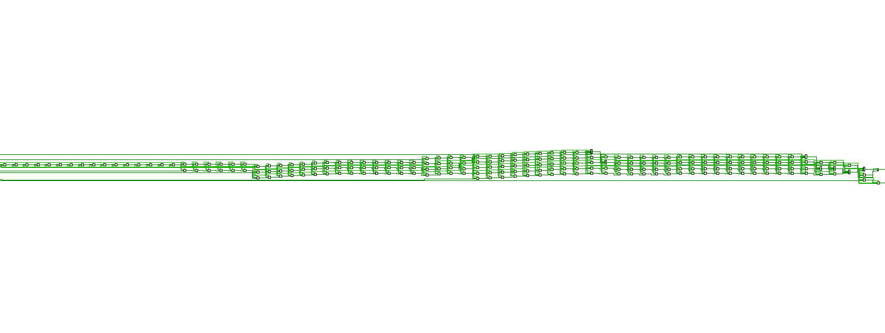

# Design & Implementation of a High-Speed MPPT Controller using FPGA for Nano Grid Applications

This repository contains the model-based design, system schematics, VHDL synthesis files, and performance verification waveforms for an FPGA-based Maximum Power Point Tracking (MPPT) solar controller designed for nano grid applications.

The project utilizes MATLAB/Simulink and HDL Coder to prototype the system dynamics (incorporating solar PV, battery storage, energy management system, and bidirectional DC-DC conversion) and target synthesizable VHDL for deployment on a Xilinx Artix-7 FPGA (Basys 3 board) via AMD Vivado.

---

## 📌 Key System Features
* **Model-Based Design (MBD) Workflow:** Rapid control algorithm prototyping in MATLAB/Simulink with direct VHDL translation via HDL Coder.
* **FPGA Logic Synthesis:** Synthesizable controller architecture validated in AMD Vivado for sub-microsecond duty cycle response.
* **Nano Grid Management:** Integrated system modeling covering solar PV generation, battery energy storage, bidirectional power flow control, and load management.

---

## 📐 System Block Diagrams & Architecture

The high-level architecture spans multiple subsystem models capturing power stage dynamics, control logic, and hardware translation layers:

| Subsystem Component | Model Schematic |
| :--- | :--- |
| **Top-Level Nano Grid Architecture** | `` |
| **Solar MPPT Subsystem** | `` |
| **HDL Extraction Module** | `` |
| **Energy Management System (EMS)** | `` |
| **Battery Storage Subsystem** | `` |
| **Bidirectional Converter Subsystem** | `` |
| **DC Load Management Subsystem** | `` |

### Detailed Block Layout Preview


---

## 📊 Simulation & Synthesis Results

The system response and timing behavior were verified across full-system MATLAB/Simulink scopes and hardware-level Vivado logic analyzer (`XSIM`) simulations.

### Vivado Behavioral Simulation
Behavioral timing waveforms confirm dynamic clock tracking, steady-state input processing ($34.0\text{ V} / 3.5\text{ A}$), and precise output duty cycle calculations ($DC \approx 0.164$):



### Hardware Synthesized Netlist Schematic
RTL analysis and logic synthesis generated the hardware primitive routing inside Xilinx Vivado:



### Subsystem Performance Plots
| Metric | Result Visualization |
| :--- | :--- |
| **Solar Output Voltage** | `` |
| **Solar Output Power** | `` |
| **Solar Output Current** | `` |
| **Battery Subsystem Current** | `` |
| **Battery Voltage Curve** | `` |
| **DC Load Waveform** | `` |
| **Nano Grid Output Voltage** | `` |

---

## 📁 Repository Directory Structure

```text
.
├── src/                      # Synthesizable VHDL source files & HDL Coder output
├── sim/                      # Vivado simulation testbenches (.vhd) & waveform configs (.wcfg)
├── docs/                     # Documentation assets and screenshots
│   ├── block_diagrams/       # Subsystem block diagrams and Simulink schematics
│   │   ├── Battery_SUBSYSTEM.png
│   │   ├── Bidirectional_Converter_SUBSYSTEM.png
│   │   ├── DC_LOAD_SUBSYSTEM.png
│   │   ├── EMS_SUBSYSTEM.png
│   │   ├── HDL_extraction_MPPT.png
│   │   ├── nano_grid.png
│   │   └── Solar_MPPT_SUBSYSTEM.png
│   └── system_results/       # Vivado simulation outputs, schematics, and scope plots
│       ├── BATTERY_SUBSYSTEM_CURRENT_WAVEFORM.png
│       ├── BATTERY_SUBSYSTEM_WAVEFORM.png
│       ├── DC_LOAD_SUBSYSTEM_WAVEFORM.png
│       ├── graphofcurrent.png
│       ├── graphofsolarPo.png
│       ├── ngcv.jpg
│       ├── schematic.png
│       ├── simulation.png
│       └── wospikevoltage.jpg
└── README.md                 # Project summary and portfolio overview
